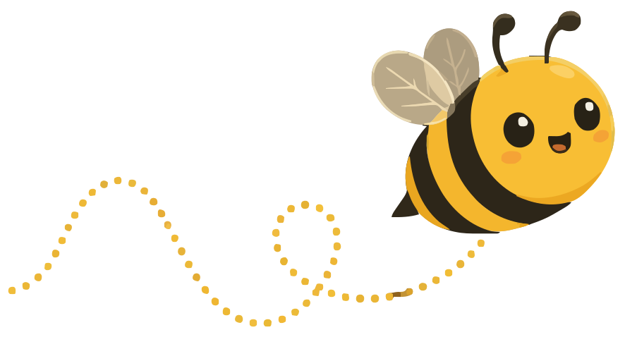

<p align="center"></p>

<h1 align="center">MurmurBee</h1>
<p align="center"><b>Just murmur. It writes.</b><br>Private, fully local AI dictation for the Mac.</p>

Hold a key, speak naturally in any app, let go: MurmurBee pastes clean, well-formatted text at your cursor.
Speech recognition and cleanup both run on your Mac. No account, no server, nothing leaves the machine.

## Why
- **Fast.** On a MacBook Air M4, the median time from releasing the key to text appearing was 0.31 s across 19 real
  dictations (Wispr Flow: 0.65 s median on the same Mac). Speech is transcribed in chunks while you talk, so long
  dictations don't wait at the end.
- **Private.** Audio is never stored or sent anywhere. Only the text history is kept, locally, and you can delete it in one click.
- **Writes like you meant it.** Removes fillers, follows self-corrections ("Tuesday, sorry, Wednesday"), formats lists,
  emails and sign-offs, and spells names right using your dictionary and what's on screen.
- **Learns.** Fix a word after it's pasted and MurmurBee adds it to your dictionary.

## How it works
1. **Speech:** NVIDIA Parakeet TDT 0.6B via [FluidAudio](https://github.com/FluidInference/FluidAudio) on the Apple Neural Engine.
2. **Cleanup:** a small Qwen3.5-0.8B model, LoRA fine-tuned for transcript cleanup, via [MLX Swift](https://github.com/ml-explore/mlx-swift-lm) on the GPU.
   It sees the app you're in, nearby text, your selection and your dictionary, and is guarded by checks that stop it
   inventing, dropping or repeating content.
3. **Paste:** clipboard plus ⌘V at the cursor, verified through Accessibility, with your previous clipboard restored.

How it was built, with the models, experiments and results: [How I built MurmurBee](https://murmurbee.com/blog/how-i-built-murmurbee/).

## Download
**[Download MurmurBee for Mac](https://github.com/kai-kaushik/murmurbee/releases/latest/download/MurmurBee.dmg)** (beta, Apple Silicon, macOS 15+).
Open the DMG and drag MurmurBee into Applications. It's signed and notarized by Apple, so it opens like any other
app. On first run MurmurBee downloads its speech model and the
[general cleanup model](https://github.com/kai-kaushik/murmurbee/releases/tag/models-v1) (trained only on synthetic
data, verified by checksum); after that it works offline.

## Status
Beta. Signed and notarized. You can import your Wispr Flow history (read-only) and train a personal model on your own
Mac, overnight; MurmurBee only switches to it if it beats the model you're using. (The personal models I use are
trained on my own dictations and aren't published.)

## Build from source
Requires an Apple Silicon Mac, macOS 15+, Xcode and the Metal toolchain (`xcodebuild -downloadComponent MetalToolchain`).
```bash
cd app && ./build.sh      # builds and installs /Applications/MurmurBee.app
```
See [app/README.md](app/README.md) for permissions, settings and debugging.

## Repository
| Path | What |
|---|---|
| `app/` | The Swift menu-bar app |
| `scripts/` | Data export, training-set builders, evaluation, sounds and icons |
| `bench/` | Benchmark harnesses and results |
| `docs/` | Experiment log |
| `site/` | The murmurbee.com landing page |
| `brand/` | Logo and icon sources |

## Licence
MIT, see [LICENSE](LICENSE). The bundled Sora font is under the SIL Open Font License (`app/Resources/fonts/OFL.txt`).
Model weights keep their own licences (Parakeet: CC-BY-4.0; Qwen: Apache-2.0).

MurmurBee is an independent project and isn't affiliated with Wispr.
